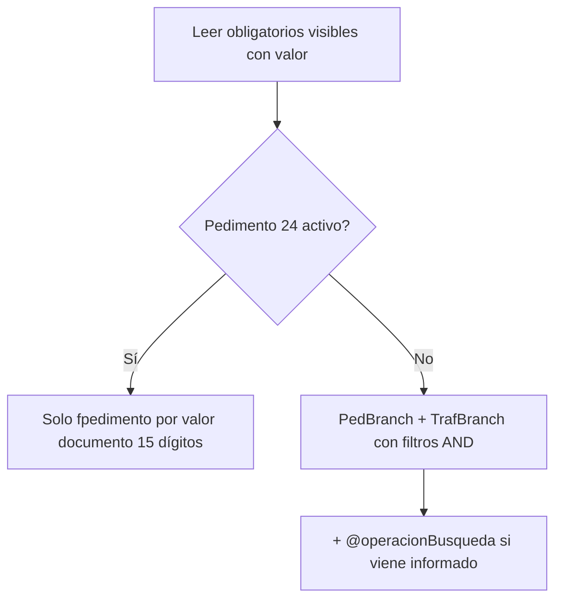

# Decisiones — Filtros por campos obligatorios del motor

**Estado:** ✅ implementado en BD (`SQL/implementacion/05` y `06`) y API (Fase 5).  
**Versión actual (sin cambios en BD):** `csp_Ad_SugerenciaPedimentos`, `csp_Ad_DiagnosticoSugerenciaPedimentos`.  
**Versión nueva:** `csp_Ad_SugerenciaPedimentos_v2`, `csp_Ad_DiagnosticoSugerenciaPedimentos_v2` — ver [guia-implementacion.md](./guia-implementacion.md).  
**Baselines:** [SQL/referencia/](./SQL/referencia/).  
**Scripts objetivo:** `SQL/implementacion/05` y `06` — aplicados en ADUASIS.

## Objetivo

Que la **recuperación de sugerencias** y el **diagnóstico de relación** filtren operaciones usando **todos los campos del motor** que cumplan:

```text
ad_motor_config_detalle.Visible = 1
AND ad_motor_config_detalle.Obligatorio = 1
AND ad_documentos_campos.Valor IS NOT NULL / <> ''
```

Resolución en SP vía `@idAdDocumento`:

```text
ad_documentos
  → IdMotorConfigHeader → ad_motor_config_header
  → ad_motor_config_detalle (Visible, Obligatorio, IdCampo)
  → ad_documentos_campos (Valor)
```

## Reglas generales

| # | Regla |
|---|--------|
| 1 | Filtros leídos en el SP; no se envían clave/tipo/fracción desde API/front. |
| 2 | Solo campos **Visible = 1** y **Obligatorio = 1**. |
| 3 | Entre filtros activos (con valor): combinación **AND**. |
| 4 | Obligatorio sin valor en documento → **se ignora** ese filtro. |
| 5 | Valores múltiples en documento (`;`) → **OR** entre ellos dentro del mismo campo. |
| 6 | `@idCliente` se mantiene como hoy (cliente del documento). |
| 7 | Parámetro **`@operacionBusqueda`** (renombrado desde `@pedimento`) en **ambos** SPs; ver sección dedicada. |
| 8 | Tráfico “sin pedimento”: el `NOT EXISTS` contra `fpedimento` solo aplica si `NULLIF(RTRIM(fgt.id_referencia),'') IS NOT NULL` **y** `fped.id_cliente = fgt.id_cliente`. Sin esto, en SQL Server `'' = ' '` hace que un pedimento con referencia vacía (aunque sea de otro cliente) excluya todos los tráficos con `id_referencia` en blanco/espacio. |

### Parámetro `@operacionBusqueda` (sugerencia y diagnóstico)

Renombre en **los dos** stored procedures:

| Antes (baseline) | Después |
|------------------|---------|
| `@pedimento` | `@operacionBusqueda` |

| Concepto | Rol |
|----------|-----|
| **`@operacionBusqueda`** | Filtro de **entrada** opcional: acota resultados por texto de búsqueda (número de pedimento, referencia o id. de tráfico — misma semántica que el baseline `@pedimento`). |
| **AdCampos.Pedimento (24)** | Valor en `ad_documentos_campos`. Criterio de filtro del documento; cuando está activo como atajo, **reemplaza** el uso de `@operacionBusqueda`. |

**Cuándo se omite `@operacionBusqueda`:** solo si **Pedimento (24)** está visible, obligatorio **y** tiene valor en el documento (regla especial / atajo). En ese caso la localización usa el valor de 15 dígitos del documento, no el parámetro de entrada.

**Cuándo sí aplica:** en cualquier otro caso, si el front envía valor en `@operacionBusqueda`, se aplica búsqueda por `pedimento`/`id_referencia`/`id_trafico` (LIKE) y también el formato UI `id_referencia/id_rectificacion` (p.ej. `EXP-29063/0`), alineado con el diagnóstico.

**Semántica AND entre filtros de partida:** el AND es **entre campos** (debe cumplirse proveedor **y** producto **y** fracción, etc.), no “en la misma fila de `fdtrafico`”. Cada campo se valida con `EXISTS` independiente sobre las partidas de la operación (igual que el diagnóstico). Exigir todos los criterios en la misma partida generaba diag OK / sugerencias vacío.

### Campos que **no aplican** al filtro

| IdCampo | Campo | Motivo |
|---------|-------|--------|
| 1 | IdCliente | Ya cubierto por `@idCliente` |
| 2 | RfcCliente | No aplica |
| 11 | Cantidad | Omitido explícitamente |
| 14–15 | VigenciaDesde / VigenciaHasta | No aplica |
| 17–19 | FirmaDeRL, Nom, ValorComercial | No aplica |
| 22 | ValorUsd | No aplica |
| 100–101 | CadenaOriginal, CodigoQR | No aplica |

## Mapeo AdCampos → ADUASIS

Solo cuando el campo es obligatorio, visible y tiene valor.

| Id | AdCampos | Columna / tabla ADUASIS | Match |
|----|----------|-------------------------|--------|
| 3 | TipoPedimento | `fpedimento.id_tipo_pedimento` / `fgtrafico.id_tipo_pedimento` | Igual que baseline |
| 4 | TipoOperacion | `fpedimento.cve_tipo_operacion` / conversión tráfico | Normalizar alias → `'1'`/`'2'` (`FN_Ad_NormalizarTipoOperacion`: Importación/Impo/IMP → `1`, Exportación/Expo → `2`) |
| 5 | ClavePedimento | `fpedimento.id_regimen` / `fgtrafico.id_regimen` | Exacto; múltiples → OR |
| 6 | Proveedor | `fdtrafico.id_proveedor` | Exacto |
| 7 | ProductoNoDeParte | `fdtrafico.id_producto` | Exacto; múltiples (`;`) → OR; `DISTINCT` ante repetidos |
| 8 | DescripcionMercancia | `fdtrafico.descripcion_clasificacion` **o** `fpedimento_detalle.descripcion_fraccion` | Exacto; múltiples (`;`) → OR; `DISTINCT` ante repetidos; basta coincidir en una de las dos fuentes |
| 9 | Fracciones | `fdtrafico.id_fraccion` | Múltiples → OR |
| 10 | Nico | `fdtrafico.nico` **o** `fpedimento_detalle.sub_fraccion` | **Numérico**: convertir ambos lados antes de comparar (`00` = `0`) |
| 12 | UnidadMedidaUMT | `fdtrafico.id_unidad_universal` **o** `fdtrafico.cve_unidad_tarifa` (y lo mismo en `fpedimento_detalle`) | Resolver texto en `funidad_universal` → uno o más ids: exacto (`=`) contra `id_unidad_universal` y `cve_unidad_oficial`; contiene (`LIKE '%...%'`) contra `descripcion` y `desc_abreviada`; filtrar con OR si hay varios; basta coincidir en cualquiera de las dos columnas |
| 13 | PaisOrigenDestino | `fdtrafico.id_pais_origen` / `id_pais_vendedor` | Múltiples → OR |
| 16 | Aduana | `fpedimento.id_aduana + seccion` / tráfico | Igual que baseline |
| 20 | Factura | Ver joins factura abajo | Exacto |
| 21 | FechaFactura | Ver joins factura abajo | Exacto (fecha) |
| 23 | GuiaBl | `fpedimento_guia.guia` | Join por `id_referencia` + `id_rectificacion`; múltiples → OR |
| 24 | Pedimento | `fpedimento` | **Regla especial** (ver abajo) |

## Joins — Factura / Fecha factura

### Rama tráfico (sin pedimento)

```sql
FROM ADUASIS.dbo.fgtrafico fgt
INNER JOIN ADUASIS.dbo.fdtrafico fdt
    ON fdt.id_trafico = fgt.id_trafico
INNER JOIN ADUASIS.dbo.fdfactura fdf
    ON fdf.id_entrada = fdt.id_entrada
       AND fdf.id_cliente = fgt.id_cliente
       AND fdf.id_proveedor = fdt.id_proveedor
       AND fdf.id_producto = fdt.id_producto
INNER JOIN ADUASIS.dbo.fgfactura fgf
    ON fgf.id_factura = fdf.id_factura
       AND fgf.id_cliente = fdf.id_cliente
       AND fgf.id_proveedor = fdf.id_proveedor
       AND fdf.id_entrada = fdf.id_entrada
```

Filtro: `fgfactura.id_factura` (20) y/o `fgfactura.fecha` (21) vs valor del documento.

### Rama pedimento

```sql
FROM ADUASIS.dbo.fpedimento fped
INNER JOIN ADUASIS.dbo.frel_pedimento_factura rel
    ON rel.id_referencia = fped.id_referencia
       AND rel.id_rectificacion = fped.id_rectificacion
```

Filtro: `rel.id_factura` (20) y/o `rel.fecha_factura` (21) vs valor del documento.

## Join — Guía/BL (23)

```sql
-- Sobre fpedimento ya localizado
INNER JOIN ADUASIS.dbo.fpedimento_guia pg
    ON pg.id_referencia = fped.id_referencia
       AND pg.id_rectificacion = fped.id_rectificacion
```

Comparar `pg.guia` con valores del documento (múltiples → OR).

## Regla especial — Pedimento (IdCampo 24)

Si **Pedimento** está visible, obligatorio **y** tiene valor (15 dígitos):

1. **Se omiten todos los demás filtros** de campos obligatorios del motor.
2. **Se excluye la rama de tráfico** (`UNION ALL` tráfico sin pedimento).
3. **No se aplica `@operacionBusqueda`** (el atajo usa el valor del documento, no búsqueda manual).
4. Búsqueda directa en `fpedimento` fragmentando los 15 dígitos + `id_cliente` del documento.

### Formato 15 dígitos (opción A — confirmada)

Coherente con [decisiones-negocio.md](./decisiones-negocio.md):

```text
Ejemplo: 26 80 3438 6543210  →  268034386543210

Posición   Longitud   Campo fpedimento
1–2        2          (año — no filtra en SP)
3–4        2          id_aduana
5–8        4          id_patente
9–15       7          pedimento
```

```sql
-- Pseudocódigo fragmentación
@aduana   = SUBSTRING(@valorPedimento, 3, 2)
@patente  = SUBSTRING(@valorPedimento, 5, 4)
@numPed   = SUBSTRING(@valorPedimento, 9, 7)

WHERE fped.id_cliente = @idCliente
  AND fped.id_aduana = @aduana
  AND fped.id_patente = @patente
  AND fped.pedimento = @numPed
```

## Flujo de ramas en sugerencia



Condiciones comunes de baseline que se mantienen (pago/firma banco, no asociado previamente, etc.) salvo que el rediseño indique lo contrario en implementación.

## Diagnóstico (`csp_Ad_DiagnosticoSugerenciaPedimentos`)

- **Mismas reglas** de filtro que sugerencia (AND, mapeos, atajo Pedimento 24).
- Filas de validación: **solo** campos obligatorios visibles **con valor**, más filas fijas operativas (pago banco, firma banco, asociación previa, datos de operación, etc.).
- Eliminar lógica OR legacy (“Filtros del documento clave, tipo, aduana…”).

## Contrato API (propuesta aprobada)

Parámetros de filtro de campos del documento (`clavePedimento`, `tipoOperacion`, etc.) **se eliminan** del request; el SP los resuelve vía `@idAdDocumento`.

### Sugerencia (`csp_Ad_SugerenciaPedimentos_v2`)

```text
@idCliente           VARCHAR(10)
@idAdDocumento       BIGINT
@operacionBusqueda   VARCHAR(40) = ''   -- renombrado desde @pedimento; omitido si atajo Pedimento 24
@PageNumber          INT
@PageSize            INT
```

### Diagnóstico (`csp_Ad_DiagnosticoSugerenciaPedimentos_v2`)

```text
@idCliente           VARCHAR(10)
@idAdDocumento       BIGINT
@operacionBusqueda   VARCHAR(40)        -- renombrado desde @pedimento; operación candidata a diagnosticar
```

En diagnóstico, `@operacionBusqueda` identifica **qué operación evaluar** (fila elegida en UI). También se omite si el atajo Pedimento (24) está activo y la localización usa el valor del documento.

DTO/API: propiedad **`OperacionBusqueda`** (no reutilizar `Pedimento`, reservado al campo AdCampos 24).

### Impacto en capas (implementado)

| Capa | Cambio | Estado |
|------|--------|--------|
| `csp_Ad_SugerenciaPedimentos_v2` | CREATE; `@operacionBusqueda`; filtros desde motor | ✅ BD |
| `csp_Ad_DiagnosticoSugerenciaPedimentos_v2` | CREATE; mismas reglas | ✅ BD |
| `csp_Ad_SugerenciaPedimentos` / `Diagnostico...` (v1) | Sin cambios | Intocable |
| `AduasisDbContextServices` | `FromSqlRaw` → `_v2` | ✅ |
| `SugerenciaPedimentosRequest` | `OperacionBusqueda` | ✅ |
| `MotorConfigController` | Payload simplificado | ✅ |
| `DocumentRepositoryListPage` | Sin mapeo manual de campos al payload | ✅ |

## Cambio vs baseline actual

| Aspecto | Baseline | Objetivo |
|---------|----------|----------|
| Origen filtros | Parámetros API/front | SP + motor + `ad_documentos_campos` |
| Clave/tipo/aduana | OR | AND (si activos) |
| Cantidad (11) | N/A | **Omitida** |
| Nico (10) | Texto | Comparación **numérica** |
| Valor USD (22) | N/A | **No aplica** |
| Pedimento (24) | N/A | Atajo: solo `fpedimento` por 15 dígitos del documento; sin rama tráfico; sin `@operacionBusqueda` |
| `@pedimento` → `@operacionBusqueda` | Ambos SPs | **Renombrado**; aplica salvo atajo Pedimento 24 |
| Params clave/tipo/fracción/país | Enviados por API | **Eliminados**; SP lee motor + documento |

## Historial de decisiones

| Fecha | Tema |
|-------|------|
| 02/07/2026 | Reglas generales, mapeos, joins factura/guía, atajo Pedimento, API, diagnóstico |
| 02/07/2026 | `@operacionBusqueda` en sugerencia y diagnóstico (renombre de `@pedimento`); omitido solo con atajo Pedimento 24 |
| 04/07/2026 | SPs `_v2` en paralelo a v1 — ver [guia-implementacion.md](./guia-implementacion.md) |
