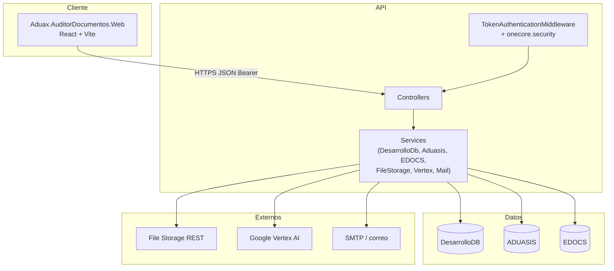

# Arquitectura general

## Propósito del sistema

**Auditor de Documentos (ITAduax / Aduax)** es una solución para:

1. **Repositorio de documentos** vinculados a tipos del catálogo **VUCEM** (consultados desde **EDOCS**).
2. **Motor de configuración** por cliente y tipo de documento (campos, clasificación, validaciones contra catálogos de **Aduasis**).
3. **Extracción de datos con IA** (Google **Vertex AI**) sobre PDFs, según prompts y configuración en **DesarrolloDB**.
4. **Flujo de aprobación** (preguardado, pendiente, autorizado, rechazado, eliminación lógica).
5. **Notificaciones por correo** (configuración manual + **BackgroundService** diario para documentos por vencer).
6. **Asociación a operaciones** (referencia, rectificación, pedimento) e integración con e-Docs (`ad_rel_documento_edoc`).

El front (React) consume la API; la API orquesta tres bases SQL Server y servicios externos.

## Diagrama de capas

## Bases de datos y responsabilidad

| Contexto EF | Connection string | Rol |
|---------------|-------------------|-----|
| `DesarrolloDB_DBContext` | `DesarrolloDB` | Tablas propias del módulo (`ad_*`): documentos, motor, IA, notificaciones, bitácora, relación e-Docs |
| `Aduasis_DBContext` | `Aduasis` | Catálogos operativos (`FCliente`, `FAduana`, `FRegimen`, `FUsuario`) y SPs de sugerencia/diagnóstico de pedimentos |
| `EDOCS_DBContext` | `EDOCS` | Catálogo VUCEM (`TbDocumentosVucem`) |

La lógica de negocio **no** debe mezclar contextos en un solo repositorio genérico: cada acceso pasa por su servicio (`IDesarrolloDb_DbContextServices`, `IAduasisDbContextServices`, `IEDOCS_DbContextServices`).

## Flujos de negocio resumidos

### Alta de documento

1. Usuario elige cliente y tipo VUCEM en el front.
2. **Preguarda** → crea registro y archivo (File Storage).
3. Opcional: **ExtraDatosDocumentoIa** → Vertex analiza PDF; campos se guardan en `ad_documentos_campos` y bitácora/ejecución IA.
4. **GuardaDocumentoPendienteAprobacion** → estatus pendiente.
5. **AutorizaDocumento** / **RechazarDocumento** → aprobaciones y estatus final.

### Configuración del motor

- Pantalla `/config` → endpoints `MotorConfig/*` (cabecera + detalle de campos, validaciones de fracción/UM/país, sugerencias de pedimentos).

### Notificaciones

- Configuración: `NotificacionConfig/*`.
- Proceso automático: `NotificacionVencimientoService` (hosted) ejecuta ~03:00 y delega en `INotificacionVencimientoProcessor`.

## Autenticación e integración con el ecosistema OneCore

- El usuario llega al front con **`?token=...`** en la URL (token cifrado OneCore).
- `httpClient.js` envía `Authorization: Bearer {token}`.
- `TokenAuthenticationMiddleware` valida solo endpoints con `[Authorize]`, decodifica con `AppSettings.KeyToken` y deja `TokenLoginDTO` en `HttpContext.Items`.
- Los controladores obtienen usuario con `HttpContext.GetTokenLoginDTO()`.

Swagger queda excluido de validación de token.

## Despliegue y rutas

| Componente | Ruta / URL típica |
|------------|-------------------|
| Front (producción) | Subruta `/AuditorDocumentos/` (`vite.config.js` → `base`) |
| API (producción) | Ej. `http://192.168.6.185/AuditorDocumentosApi/` (`config/api.js`) |
| API (desarrollo) | `https://localhost:7031/` |

CORS en `Program.cs` permite orígenes Vite (`5173`, `5174`) y localhost.

## Dependencias externas (NuGet / DLL)

- **EF Core 8** + SqlServer
- **Google.Cloud.AIPlatform.V1**, **Google.Cloud.Storage.V1**
- **Swashbuckle** (Swagger en Development)
- **Shared.Utilerias** (utilidades internas Aduax)
- **DLL** `onecore.security.encryptvr`, `onecore.security.services` en `src/DLL/`

## Scripts SQL

Los cambios de esquema y SPs viven en `docs/SQL/` y subcarpetas (`docs/auto-edocs/SQL/`). Al agregar un SP:

1. Script versionado en `docs/`.
2. Entidad keyless o resultado en el `DbContext` correspondiente.
3. Invocación vía `FromSqlRaw` / `ExecuteSqlRawAsync` en el servicio de datos.
