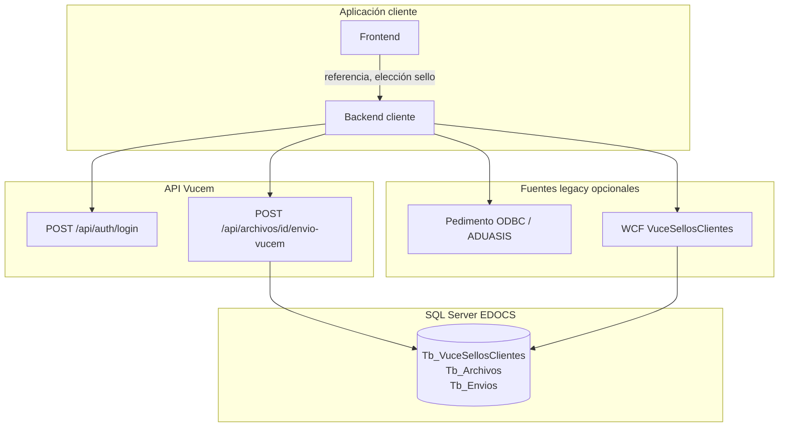
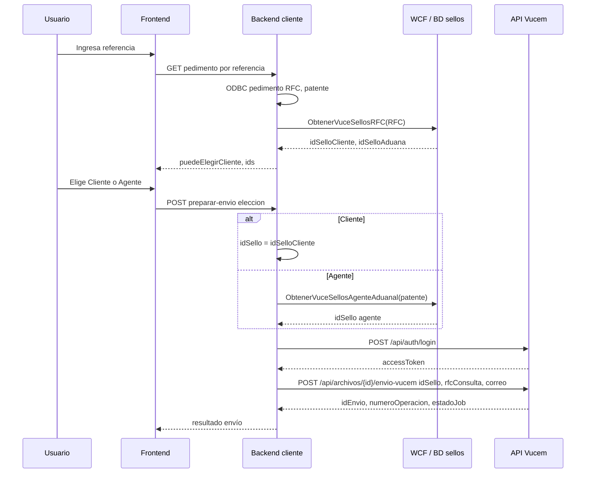

# Guía para aplicación cliente — envío a VUCEM con `idSello`

Documento orientado a equipos que construyen una **aplicación en dos capas** (frontend + backend propio) y consumen la **API Vucem** (`src/Vucem/Vucem.Api`). El objetivo es **desacoplar** la lógica que hoy vive en eDocs (`FrmSeleccionSellos`, ODBC, WCF) y enviar a la API únicamente el **`idSello` ya elegido**, más los datos mínimos del pedimento/archivo.

Referencias en este repositorio:

- Flujo legacy: [flujo-tb-archivos-envios-edocument-vucem.md](flujo-tb-archivos-envios-edocument-vucem.md)
- Plan API: [plan-api-vucem-archivo-worker-net10.md](plan-api-vucem-archivo-worker-net10.md)

---

## 1. Resumen ejecutivo

| Responsabilidad | ¿Quién la tiene? |
|-----------------|------------------|
| Cargar pedimento (referencia, RFC importador, patente) | **Backend cliente** (o frontend vía su API) |
| Consultar si existe sello de cliente (`Id_Sello_Cliente`) | **Backend cliente** (equivalente `ObtenerVuceSellosRFC`) |
| Mostrar diálogo Cliente / Agente aduanal | **Frontend** |
| Resolver y guardar el `Id_Sello` elegido | **Frontend + backend cliente** |
| Descargar PDF, 300 DPI, SOAP VUCEM, worker eDocument | **API Vucem** |

La API **ya acepta** `idSello` en el body de `POST /api/archivos/{idArchivo}/envio-vucem`. Si envías `idSello > 0`, la API **no vuelve a elegir** el sello por patente/RFC; solo valida que exista en `Tb_VuceSellosClientes` y carga certificados desde FileStorage/FTP.

---

## 2. Arquitectura recomendada



**Principio:** el frontend no debería llamar a la API Vucem con secretos de aplicación ni exponer la API key. El **backend cliente** hace login JWT, orquesta la selección de sellos y llama a Vucem.

---

## 3. Equivalencia con eDocs (`FrmSeleccionSellos`)

En eDocs desktop ocurre lo siguiente **antes** del envío:

1. Al cargar la **referencia**, ODBC devuelve RFC y patente del pedimento.
2. WCF `ObtenerVuceSellosRFC(RFC)` devuelve `Id_Sello_Cliente` e `Id_Sello_Aduana` (guardados en `My.Settings`).
3. Si `Id_Sello_Cliente = 0` → solo se permite sello de **agente aduanal** (botón Cliente deshabilitado).
4. El usuario elige en `FrmSeleccionSellos`:
   - **Cliente** → `Id_Sello = Id_Patente_Cliente`
   - **Agente aduanal** → `ObtenerVuceSellosAgenteAduanal(patente)` → `pk_Id_Sello`
5. Ese `Id_Sello` se persiste en `Tb_Envios` y el hilo `DigitalEnvia` descarga `.cer`/`.key`.

En la aplicación cliente desacoplada, los pasos **1–4** son tuyos; el paso **5 (envío VUCEM)** lo hace la API Vucem cuando recibes:

```json
{ "idSello": 123, "rfcConsulta": "RFC_IMPORTADOR", "correoElectronico": "..." }
```

---

## 4. Autenticación (backend cliente)

### 4.1 Login

```http
POST /api/auth/login
Content-Type: application/json

{
  "nombre": "NombreAplicacionEnTb_AplicacionApi",
  "apiKey": "clave-configurada-en-Tb_AplicacionApi"
}
```

**Respuesta 200:**

```json
{
  "accessToken": "eyJ...",
  "tokenType": "Bearer",
  "expiresIn": 3600,
  "idAplicacion": 1,
  "nombre": "NombreAplicacionEnTb_AplicacionApi"
}
```

### 4.2 Llamadas siguientes

```http
Authorization: Bearer {accessToken}
```

### 4.3 Verificar sesión (opcional)

```http
GET /api/auth/me
Authorization: Bearer {accessToken}
```

---

## 5. Endpoint de envío

### 5.1 Request

```http
POST /api/archivos/{idArchivo}/envio-vucem
Authorization: Bearer {accessToken}
Content-Type: application/json
```

| Campo | Tipo | Obligatorio | Descripción |
|-------|------|-------------|-------------|
| `idSello` | `int` | **Recomendado sí** | `Id_Sello` de `Tb_VuceSellosClientes`. Si `> 0`, la API usa **solo** este sello. |
| `rfcConsulta` | `string` | **Recomendado sí** | RFC del **importador** (pedimento). Va al documento VUCEM y a la cadena de firma. Equivalente eDocs `rfcCliente` / columna RFC del pedimento. |
| `correoElectronico` | `string` | Condicional | Obligatorio para VUCEM si no hay correo resoluble por `Id_Usuario` del archivo en catálogo de usuarios. |
| `nombreArchivo` | `string` | No | Si se omite, se usa el nombre de `Tb_Archivos.Ruta_Local`. |
| `patente` | `string` | No* | Solo necesaria si **no** envías `idSello` y quieres resolución automática por agente. *No usar en flujo desacoplado si ya envías `idSello`. |

### 5.2 Ejemplo — sello de cliente

Tras `ObtenerVuceSellosRFC`, el usuario eligió **Cliente** y obtuviste `idSelloCliente = 87`:

```json
{
  "idSello": 87,
  "rfcConsulta": "ABC850101ABC",
  "correoElectronico": "digitalizacion@empresa.com"
}
```

### 5.3 Ejemplo — sello de agente aduanal

Tras `ObtenerVuceSellosAgenteAduanal` con patente `3589`, obtuviste `idSello = 42`:

```json
{
  "idSello": 42,
  "rfcConsulta": "ABC850101ABC",
  "correoElectronico": "digitalizacion@empresa.com"
}
```

### 5.4 Respuesta 200 (`EnvioVucemResponse`)

```json
{
  "idArchivo": 12345,
  "idEnvio": 67890,
  "numeroOperacion": "1234567890",
  "mensaje": "Su peticion se proceso correctamente",
  "estadoJob": 1,
  "esExitoso": true,
  "tiempoEjecucionMs": 4500
}
```

| Campo | Significado |
|-------|-------------|
| `numeroOperacion` | Número de operación VUCEM guardado en `Tb_Envios.Numero` |
| `estadoJob` | Estado inicial del worker de consulta eDocument (`1` = `Enviado`) |
| `esExitoso` | `true` si el **registro** en VUCEM fue exitoso |

Valores de `estadoJob` (`EstadoSeguimientoVucem`):

| Valor | Nombre |
|------:|--------|
| 0 | Pendiente |
| 1 | Enviado |
| 2 | Consultando |
| 3 | Completado |
| 4 | Error |
| 5 | Cancelado |

El worker consulta eDocument de forma asíncrona y actualiza `Tb_Envios.Edocument` (no es necesario que el cliente haga polling en v1, salvo que expongan **consulta propia sobre BD** — ver §18 para **Auditor de Documentos**).

### 5.5 Códigos HTTP de error

| Código | Cuándo | Acción sugerida |
|--------|--------|-----------------|
| **401** | JWT inválido o expirado | Renovar con `/api/auth/login` |
| **404** | `idArchivo` o `idSello` inexistente | Validar IDs antes de enviar |
| **409** | Envío API en curso para el mismo archivo, PDF no válido, etc. | Mostrar mensaje; esperar job o revisar archivo |
| **400** | Registro VUCEM falló (`esExitoso: false` en body) | Mostrar `mensaje`; revisar sello, correo, tipo documento |

Ejemplo **404** sello:

```json
{ "mensaje": "No existe sello con Id_Sello 99999." }
```

Ejemplo **409**:

```json
{ "mensaje": "El archivo 12345 tiene un envío API en curso (Id_Envio 67890). Espere..." }
```

---

## 6. Cómo obtener los `idSello` en el backend cliente

La API Vucem **no expone** (en esta versión) endpoints públicos de catálogo de sellos. El backend cliente debe obtener los IDs igual que eDocs, por ejemplo:

### 6.1 Por RFC del importador (cliente / aduana)

Equivalente WCF: `ObtenerVuceSellosRFC(RFC)` → SP `csp_VuceSellosClientes_RFC`.

| Resultado | Uso en UI |
|-----------|-----------|
| `Id_Sello_Cliente > 0` | Habilitar opción **Sello cliente**; valor a enviar si el usuario elige cliente |
| `Id_Sello_Cliente = 0` | Deshabilitar cliente; ofrecer alta de sellos o solo agente |
| `Id_Sello_Aduana` / patente | Referencia informativa; el agente se resuelve por patente |

### 6.2 Por patente (agente aduanal)

Equivalente WCF: `ObtenerVuceSellosAgenteAduanal(patente)` → SP `csp_VuceSellosClientes_Sel_AgenteAduanal_AmazonS3`.

Devuelve el registro del agente (`pk_Id_Sello`, rutas Amazon, RFC, etc.).

### 6.3 Tabla de decisión UI (frontend)

| Condición | Botón Cliente | Botón Agente | `idSello` a enviar a Vucem |
|-----------|---------------|--------------|----------------------------|
| `Id_Sello_Cliente > 0`, usuario elige Cliente | Habilitado | Habilitado | `Id_Sello_Cliente` |
| `Id_Sello_Cliente = 0` | Deshabilitado | Habilitado | `pk_Id_Sello` del agente |
| Usuario cancela | — | — | No llamar a Vucem |

---

## 7. Flujo recomendado — secuencia



---

## 8. Contrato API — modo desacoplado (recomendado)

Para evitar ambigüedad, el backend cliente debería:

1. **Siempre** enviar `idSello` cuando el usuario ya eligió.
2. **Siempre** enviar `rfcConsulta` con el RFC del pedimento (importador).
3. Enviar `correoElectronico` si lo tiene el usuario o del perfil; si no, la API intenta resolverlo por `Id_Usuario` del archivo.
4. **No** depender de `patente` en el body hacia Vucem si ya envías `idSello`.

Campos que puede omitir el cliente en modo desacoplado:

- `patente` (la API la ignora para resolver sello si `idSello` viene informado)

---

## 9. Modo legacy en la API (sin `idSello`)

Si **no** envías `idSello`, la API intenta resolver en este orden:

1. `patente` → sello agente aduanal (`csp_VuceSellosClientes_Sel_AgenteAduanal_AmazonS3`)
2. `rfcConsulta` → sello cliente (`csp_VuceSellosClientes_RFC` → `Id_Sello_Cliente`)

Este modo **no replica** el diálogo eDocs (no sabe si el usuario quiso cliente o agente si ambos existen). Por eso el modo desacoplado debe usar **`idSello` explícito**.

---

## 10. Qué hace la API internamente (transparencia)

Tras recibir `idSello`, la API:

1. Lee `Tb_VuceSellosClientes` por `Id_Sello`.
2. Descarga `.cer` y `.key` vía **FileStorage** (con fallback FTP), **en memoria**.
3. Descarga el PDF de `Tb_Archivos`, convierte a **300 DPI**.
4. Firma y registra en VUCEM (SOAP).
5. Inserta/actualiza `Tb_Envios` vía SPs legacy (`csp_Envios_Ins` / `csp_Envios_Upd`).
6. Marca origen API en `Tb_Envio_ApiOrigen` y crea job en `Tb_Envio_ConsultaJob`.

El cliente **no** debe subir el PDF ni los sellos; solo identifica el archivo y el sello.

---

## 11. Precondiciones del archivo

Antes de llamar a `envio-vucem`, validar en backend cliente (consultando `Tb_Archivos` o API propia):

| Regla | Motivo |
|-------|--------|
| Archivo existe (`idArchivo`) | 404 si no |
| Es PDF (`Ruta_Local` / `Ruta_Remota`) | 409 si no |
| `Id_Documento_Vucem` configurado | Tipo documento VUCEM |
| eDocument aún no válido (opcional) | En eDocs solo envían si `Edocument = 0000000000000` |

---

## 12. Diferencias conocidas vs eDocs (importante para QA)

| Tema | eDocs | API Vucem (v1) |
|------|-------|----------------|
| Selección sello | UI `FrmSeleccionSellos` | Cliente envía `idSello` |
| RFC en cadena SOAP según tipo sello | Intercambia RFC solicitante / consulta | Usa `sello.Rfc` del registro + `rfcConsulta` del body |
| Caché local `.cer`/`.key` | Carpeta `Archivos\` | Memoria por request |
| XML acuse post-consulta | Sube a S3 + anexos | No implementado en API |

Si en pruebas VUCEM rechaza el registro con sello de **cliente**, revisar con negocio si hace falta alinear la lógica de RFC (mejora planificada en API).

---

## 13. Checklist de implementación

### Backend cliente

- [ ] Servicio de pedimento (referencia → RFC, patente, razón social).
- [ ] Servicio de sellos (`ObtenerVuceSellosRFC`, `ObtenerVuceSellosAgenteAduanal` o equivalente SQL/WCF).
- [ ] Cache de token JWT con renovación antes de `expiresIn`.
- [ ] Cliente HTTP hacia Vucem con timeout generoso (envío + 300 DPI puede tardar varios minutos).
- [ ] Endpoint propio para el frontend: p. ej. `POST /api/expedientes/{ref}/archivos/{id}/enviar-vucem` con body `{ origenSello, ... }` que traduce a `idSello`.

### Frontend

- [ ] Pantalla equivalente a `FrmSeleccionSellos` (Cliente / Agente / Cancelar).
- [ ] Deshabilitar Cliente si `idSelloCliente === 0`; opcional enlace a alta de sellos.
- [ ] Mostrar resultado: número de operación, `idEnvio`, mensaje, estado job.
- [ ] No almacenar API key de Vucem en el navegador.

### Operaciones

- [ ] Credenciales `Tb_AplicacionApi` por ambiente (dev/QAS/prod).
- [ ] FileStorage configurado en servidor Vucem (`appsettings` sección `FileStorage`).
- [ ] VPN/red hacia SQL Server y `web.aduax.com` según ambiente.

---

## 14. Ejemplo completo — backend cliente (pseudocódigo)

```text
// 1) Pedimento
pedimento = await ObtenerPedimentoPorReferencia(referencia)
rfc = pedimento.Rfc
patente = pedimento.Patente

// 2) Sellos disponibles
lookup = await ObtenerVuceSellosRfc(rfc)
puedeCliente = lookup.IdSelloCliente > 0

// 3) UI → eleccionUsuario ∈ { Cliente, Agente, Cancelar }
si eleccionUsuario == Cancelar: return

idSello = eleccionUsuario == Cliente
    ? lookup.IdSelloCliente
    : (await ObtenerAgentePorPatente(patente)).IdSello

// 4) JWT Vucem
token = await VucemLogin(nombre, apiKey)

// 5) Envío
body = {
  idSello: idSello,
  rfcConsulta: rfc,
  correoElectronico: correo  // o null si la API resuelve por Id_Usuario
}
resultado = await POST(
  $"/api/archivos/{idArchivo}/envio-vucem",
  body,
  Authorization: Bearer {token}
)
```

---

## 15. Evolución futura (API Vucem)

Posibles endpoints para simplificar el backend cliente (no disponibles hoy):

| Endpoint propuesto | Propósito |
|--------------------|-----------|
| `GET /api/sellos/por-rfc/{rfc}` | Devolver `idSelloCliente`, `idSelloPatente`, flags UI |
| `GET /api/sellos/agente?patente=` | Devolver sello agente aduanal |
| Campo `origenSello` en body | Validar coherencia `Cliente` / `AgenteAduanal` vs `idSello` |

Hasta entonces, la guía oficial para producción es: **cliente resuelve IDs; Vucem recibe `idSello`**.

---

## 16. Referencia rápida OpenAPI

En desarrollo, la documentación interactiva está en:

- OpenAPI: `/openapi/v1.json`
- Scalar UI: `/scalar/v1`

Requiere levantar `Vucem.Api` en entorno Development.

---

## 17. Contacto / archivos relacionados (API Vucem)

| Tema | Ubicación en repo |
|------|-------------------|
| Controller envío | `src/Vucem/Vucem.Api/Controllers/ArchivosVucemController.cs` |
| DTO request | `src/Vucem/Vucem.Application/Envios/EnviarArchivoVucemRequest.cs` |
| Resolver sello | `src/Vucem/Vucem.Application/Envios/EnvioVucemSelloResolver.cs` |
| Script alta app API | `docs/SQL/Tb_AplicacionApi_Create.sql` |
| Scripts jobs API | `docs/SQL/Tb_Envio_ApiOrigen_Create.sql`, `Tb_Envio_ConsultaJob_Create.sql` |

---

## 18. Implementación en Auditor de Documentos (ITAduax)

Esta sección describe cómo el repositorio **AuditorDocumentos** consume la guía sin sustituir la API Vucem. Plan detallado: [plan-integracion-envio-vucem-sellos.md](./plan-integracion-envio-vucem-sellos.md).

### 18.1 Responsabilidades alineadas con §1

| Dato / acción | Dónde en Auditor | Estado |
|---------------|------------------|--------|
| `idArchivo` (eDOCS) | `ad_rel_documento_edoc.Id_Archivo` tras `AltaAsociacionOperacion` | Implementado |
| `idSello` elegido por usuario | `AdRelDocumentoEdoc.IdSelloEdoc` | Se persiste al confirmar sello; mismo valor en body `idSello` hacia Vucem |
| `idSello` + `rfcConsulta` hacia API Vucem | `VucemApiClient` → `POST …/envio-vucem` | Implementado (requiere `VucemApi` en appsettings) |
| `Edocument` / `Mensaje` de envío | Lectura desde `EDOCS.dbo.Tb_Envios` | Implementado (solo consulta) |

### 18.2 Consulta propia sobre BD (§5.4, §200)

Tras asociar referencia, el modal de repositorio muestra pedimentos vinculados con **eDocument** sin polling a Vucem:

1. `POST /api/Documentos/ObtenerDocumentoPorId`
2. Api ejecuta `csp_Ad_GetDocumentoOperacion` (`docs/auto-edocs/SQL/20260519-03 csp_Ad_GetDocumentoOperacion.sql`)
3. El SP une `ad_documento_operacion` → `ad_rel_documento_edoc` → `Tb_Archivos` (por `Referencia`) → `Tb_Envios`
4. El front muestra `operaciones[].edocument` y `operaciones[].mensaje` (tooltip)

El **origen de verdad** del eDocument sigue siendo `Tb_Envios`, actualizado por la API Vucem y su worker. Auditor **no escribe** `Edocument` en DesarrolloDB.

### 18.3 Flujo de envío (§5, §7, §8)

1. En el modal de asociación, tabla **Pedimentos asociados**, el botón **Enviar a VUCEM** aparece **solo** si la fila no tiene `edocument` ni `mensaje` (equivalente a envío pendiente).
2. Al pulsar Enviar: `POST /api/Documentos/ObtenerSellosVucemDisponibles` (RFC/patente + SPs EDOCS).
3. `SelloVucemModal`: usuario elige **Sello cliente** o **Agente aduanal**.
4. `POST /api/Documentos/EnviarDocumentoVucem`: se guarda **`IdSelloEdoc`** en `ad_rel_documento_edoc` y se llama a la API Vucem con el mismo **`idSello`** y `rfcConsulta`.
5. Tras respuesta/worker, `ObtenerDocumentoPorId` refresca la fila (eDocument/Mensaje desde `Tb_Envios`); el botón deja de mostrarse.

Configurar en `appsettings` la sección **`VucemApi`**: `BaseUrl`, `NombreAplicacion`, `ApiKey`.

### 18.4 Validación §11 (eDocument pendiente)

Backend y front validan que no exista eDocument ni mensaje antes de enviar. En UI, `0000000000000` se trata como eDocument pendiente (sin valor definitivo).

### 18.5 Referencias en este repositorio

| Tema | Ubicación |
|------|-----------|
| Tabla relación + sello | `docs/auto-edocs/SQL/20260515-01 Create ad_rel_documento_edoc.sql` |
| SP consulta operaciones | `docs/auto-edocs/SQL/20260519-03 csp_Ad_GetDocumentoOperacion.sql` |
| Servicio EF | `GetDocumentoOperacionesConEdocumentAsync` en `DesarrolloDb_DbContextServices` |
| UI modal | `src/Aduax.AuditorDocumentos.Web/src/pages/DocumentRepositoryListPage.jsx` |
