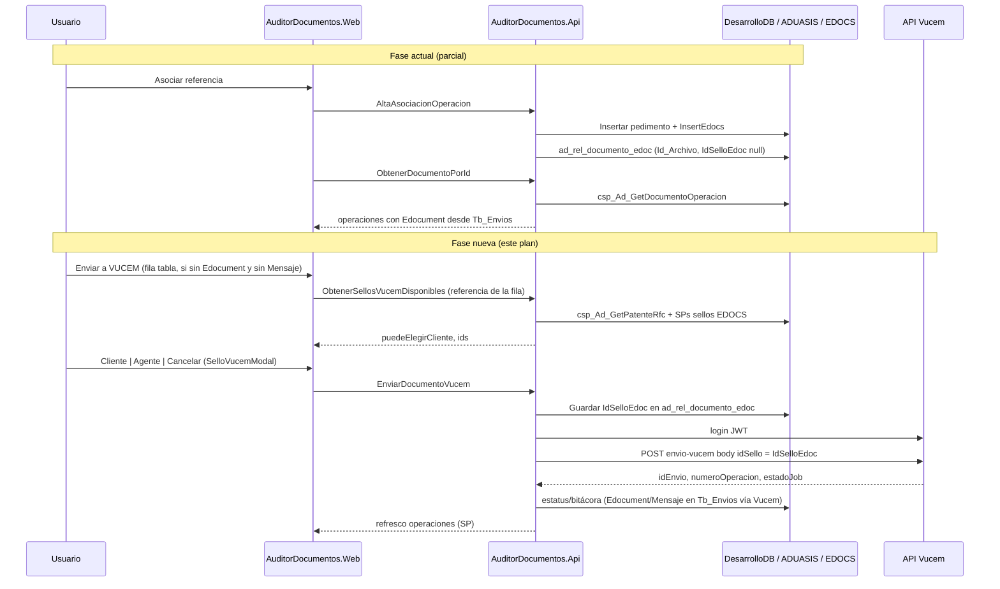

# Plan de integración — Envío VUCEM con `idSello` (Auditor de Documentos)

Documento de planificación derivado de [guia-cliente-envio-vucem-sellos.md](./guia-cliente-envio-vucem-sellos.md), alineado con el código actual en `src/` y los scripts en `docs/auto-edocs/SQL/`.

**Objetivo:** Completar el flujo desacoplado en el que **Auditor de Documentos** actúa como *backend cliente* de la **API Vucem**: el usuario elige sello en el front; la API propia orquesta pedimento, catálogo de sellos (EDOCS), persiste el sello en **`ad_rel_documento_edoc.IdSelloEdoc`** (`AdRelDocumentoEdoc`) y llama a `POST /api/archivos/{idArchivo}/envio-vucem` con el mismo **`idSello`** en el body.

**Fuera de alcance de este plan:** Cambios dentro del repositorio `Vucem.Api` (salvo coordinación de credenciales y despliegue).

### Aclaraciones de negocio (acordadas)

| Tema | Decisión |
|------|----------|
| Persistencia del sello | Tras la elección del usuario (Cliente/Agente), guardar en **`AdRelDocumentoEdoc.IdSelloEdoc`** (tabla `ad_rel_documento_edoc`). Ese valor es el que se envía en el request a la API Vucem (`idSello`). |
| Ubicación del botón “Enviar a VUCEM” | **Por fila** en la tabla “Pedimentos asociados” del modal de asociación (`DocumentRepositoryListPage`), no como acción global fuera de la tabla. |
| Cuándo mostrar el botón | Solo si la fila **no tiene eDocument** (vacío, `null` o equivalente pendiente) **y** el campo **`Mensaje`** (de `Tb_Envios`) está **vacío**. Si ya hay eDocument o mensaje de envío/error, no se ofrece reenvío desde esa fila. |

---

## 1. Estado actual vs. estado objetivo

### 1.1 Lo que ya existe en Auditor de Documentos

| Área | Implementado | Ubicación |
|------|--------------|-----------|
| Alta en eDOCS (`Tb_Archivos`) | Sí | `AltaAsociacionOperacion` → `IEDOCS_DbContextServices.InsertEdocsAsync` |
| Relación documento ↔ archivo eDOCS | Sí (parcial) | Tabla/entidad `ad_rel_documento_edoc`, `SaveRelDocumentoEdocAsync` |
| Transferencia datos pedimento/tráfico | Sí | `InsertarDatosPedimentoV2Async` |
| UI asociación referencia/pedimento | Sí | `DocumentRepositoryListPage` → `altaAsociacionOperacion` |
| Catálogo tipos VUCEM | Sí | `MotorConfig/ObtenerDocumentosVucem`, `TbDocumentosVucem` |
| Estatus `DigitalizadoEdocs` y evento `DOC_ENVIO_EDOCS` | Sí | `AdDocumentoEstatus`, `AdEventos` |
| Consulta eDocument por operación (solo lectura) | Sí | SP `csp_Ad_GetDocumentoOperacion`, `GetDocumentoOperacionesConEdocumentAsync`, `ObtenerDocumentoPorId` |
| UI columna eDocument en modal asociación | Sí | `DocumentRepositoryListPage` — tabla “Pedimentos asociados” |
| Columna `IdSelloEdoc` en relación eDOCS | Sí (esquema EF) | `AdRelDocumentoEdoc.IdSelloEdoc` — pendiente de llenar al confirmar sello/envío |

### 1.2 Brechas respecto a la guía

| Requisito (guía §) | Estado | Impacto |
|--------------------|--------|---------|
| Pedimento → RFC + patente (§6, §7) | SP documentado, **no integrado en API** | `csp_Ad_GetPatenteRfcClienteByRelOperacion` en `docs/auto-edocs/SQL/` sin llamada en C# |
| Consulta sellos por RFC / patente (§6.1–6.2) | **No implementado** | Faltan wrappers a `csp_VuceSellosClientes_RFC` y `csp_VuceSellosClientes_Sel_AgenteAduanal_AmazonS3` en EDOCS |
| UI `FrmSeleccionSellos` (§6.3, §7) | **No implementado** | Tras asociar solo se confirma operación; no hay elección Cliente/Agente |
| Cliente HTTP API Vucem + JWT (§4, §5) | **No implementado** | Sin `VucemApiCfg`, sin servicio de login/renovación de token |
| `POST envio-vucem` con `idSello` + `rfcConsulta` (§5, §8) | **No implementado** | El envío SOAP/worker queda solo en API Vucem |
| Persistir `IdSelloEdoc` + envío en API Vucem (§5, §8) | **No implementado** | Tras modal de sellos: `UPDATE ad_rel_documento_edoc` y body `{ idSello: IdSelloEdoc, rfcConsulta, … }` |
| Botón “Enviar a VUCEM” en tabla de operaciones | **No implementado** | Regla: sin `Edocument` y sin `Mensaje` en la fila |
| Consultar `Edocument` / `Mensaje` (§5.4, §200) | **Parcial (lectura)** | SP + modal muestran `Tb_Envios`; el worker de Vucem sigue siendo quien **escribe** el eDocument |
| Validaciones pre-envío (§11) | Parcial | PDF y tipo VUCEM al asociar; el modal **muestra** eDocument pero no valida `000…0` ni job en curso antes de “Enviar a VUCEM” |
| Separar secretos Vucem del navegador (§2, §13) | Cumplido por diseño | Mantener: solo **Api** llama a Vucem |

### 1.3 Flujo objetivo (resumen)



---

## 2. Decisiones de diseño (recomendadas)

| Tema | Decisión | Motivo |
|------|----------|--------|
| ¿Un solo endpoint o varios? | **Varios** en `DocumentosController` (o `VucemEnvioController`) | Alineado con guía §7: lookup sellos ≠ envío |
| ¿Cuándo enviar a VUCEM? | **Después** de `AltaAsociacionOperacion` exitosa, acción explícita del usuario | Replica eDocs: primero archivo en eDOCS, luego envío con sello |
| ¿Extender `AltaAsociacionOperacion`? | **No** (solo asociación + eDOCS) | Evita timeout largo (300 DPI + SOAP en Vucem) y permite reintento de envío |
| Resolución de `idArchivo` | Desde `ad_rel_documento_edoc` por `IdDocumento` + referencia activa | Ya se guarda en asociación |
| Dónde vive el eDocument | **`EDOCS.dbo.Tb_Envios`** (lectura vía `csp_Ad_GetDocumentoOperacion`) | No duplicar en `ad_rel`; ver §4 |
| Dónde vive el sello elegido | **`AdRelDocumentoEdoc.IdSelloEdoc`** | Persistir al confirmar modal de sellos; **mismo entero** en `POST envio-vucem` |
| Origen del `idSello` en request Vucem | Leer `IdSelloEdoc` de la fila `ad_rel` (por `IdDocumento` + referencia/rectificación) | No enviar un `idSello` distinto al guardado |
| UI envío | Botón en **cada fila** de “Pedimentos asociados” | Visible solo sin `edocument` y sin `mensaje` (ver §4.3) |
| Modo API Vucem | **Siempre** `idSello > 0` + `rfcConsulta` (§8) | No usar modo legacy sin `idSello` |
| Credenciales Vucem | `appsettings` + User Secrets; **nunca** en el front | §2, §13 |
| Timeout HTTP hacia Vucem | **≥ 5–10 min** (configurable) | §13 — envío puede ser lento |

---

## 3. Fases de implementación

### Fase 0 — Infraestructura y BD (prerrequisitos)

**Responsable:** DBA + DevOps + equipo Vucem.

| # | Tarea | Entregable |
|---|--------|------------|
| 0.1 | Ejecutar `20260515-01 Create ad_rel_documento_edoc.sql` en DesarrolloDB (si no está en ambiente) | Tabla en QAS/PROD |
| 0.2 | Ejecutar `20260518-02 Create csp_Ad_GetPatenteRfcClienteByRelOperacion.sql` | SP en DesarrolloDB |
| 0.3 | Ejecutar `20260519-03 csp_Ad_GetDocumentoOperacion.sql` | SP en DesarrolloDB (requerido por modal asociación) |
| 0.4 | Verificar SPs de sellos en EDOCS (`csp_VuceSellosClientes_RFC`, `csp_VuceSellosClientes_Sel_AgenteAduanal_AmazonS3`) | Acceso desde cadena `EDOCS` |
| 0.5 | Alta en `Tb_AplicacionApi` (API Vucem) por ambiente | `nombre` + `apiKey` para AuditorDocumentos |
| 0.6 | Configurar `VucemApi` URL base (dev/QAS/prod) y red/VPN | Conectividad desde servidor Api |
| 0.7 | Validar FileStorage en servidor **Vucem** (no solo Auditor) | §10 guía |

**Criterio de salida:** Scripts aplicados; login Vucem manual con Postman/Scalar OK.

---

### Fase 1 — Capa de datos y configuración (Api)

| # | Tarea | Detalle técnico |
|---|--------|-----------------|
| 1.1 | Config `VucemApiCfg` | Sección en `appsettings`: `BaseUrl`, `NombreAplicacion`, `ApiKey`, `TimeoutSeconds`, opcional `CorreoPorDefecto` |
| 1.2 | DTO resultado patente/RFC | Clase `CspAdGetPatenteRfcClienteRow` (`RfcCliente`, `Patente`) + método en `IDesarrolloDb_DbContextServices` → `FromSqlRaw` SP §0.2 |
| 1.3 | DTOs sellos EDOCS | Entidades keyless p. ej. `CspVuceSellosRfcResult` (`IdSelloCliente`, `IdSelloAduana`, …), `CspVuceSellosAgenteResult` (`PkIdSello`, …) según columnas reales del SP |
| 1.4 | `IEDOCS_DbContextServices` | `GetVuceSellosPorRfcAsync(rfc)`, `GetVuceSellosAgentePorPatenteAsync(patente)` |
| 1.5 | Consulta / actualización relación eDOCS | `GetRelDocumentoEdocAsync(idDocumento, idReferencia, idRectificacion?)` → `AdRelDocumentoEdoc`; **`UpdateRelDocumentoEdocIdSelloEdocAsync(idRel, idSelloEdoc)`** al confirmar sello (antes o junto con la llamada a Vucem) |
| 1.5b | Consulta operaciones + envío | **Hecho:** `GetDocumentoOperacionesConEdocumentAsync` → `csp_Ad_GetDocumentoOperacion` |
| 1.6 | VModels | `VucemSellosLookupDto`, `EnviarDocumentoVucemRequest` (`OrigenSello` enum: Cliente, AgenteAduanal), `EnvioVucemResultDto` (espejo `EnvioVucemResponse`) |

**Criterio de salida:** Tests unitarios o prueba de integración contra BD de desarrollo devolviendo RFC/patente y IDs de sello para un caso conocido.

---

### Fase 2 — Cliente HTTP API Vucem (Api)

| # | Tarea | Detalle técnico |
|---|--------|-----------------|
| 2.1 | `IVucemApiClient` + `VucemApiClient` | `HttpClient` nombrado; `LoginAsync()` → cache token en memoria (singleton) con renovación antes de `expiresIn` |
| 2.2 | `EnviarArchivoVucemAsync(int idArchivo, EnviarArchivoVucemBody)` | POST `/api/archivos/{idArchivo}/envio-vucem` con Bearer |
| 2.3 | Mapeo errores | 401 → renovar token y reintentar 1 vez; 404/409/400 → `GenericResponse` con `Message` de Vucem |
| 2.4 | Registro DI | `Program.cs`: `AddHttpClient<IVucemApiClient, VucemApiClient>()` + `Configure<VucemApiCfg>` |

**Criterio de salida:** Desde consola o endpoint de prueba temporal, envío exitoso con `idArchivo` y `idSello` de prueba en QAS.

---

### Fase 3 — Endpoints propios (Api) — contrato para el front

Propuesta de rutas (todas `[Authorize]`, POST salvo donde se indique):

| Endpoint | Request | Response | Equivalente guía |
|----------|---------|----------|------------------|
| `POST Documentos/ObtenerDatosPedimentoPorOperacion` | `GenericAdRequest<AsociacionOperacionRequest>` o `{ idReferencia, idRectificacion }` | `GenericResponse<{ rfcCliente, patente }>` | ODBC pedimento §3 paso 1 |
| `POST Documentos/ObtenerSellosVucemDisponibles` | `{ idReferencia, idRectificacion }` o RFC explícito | `GenericResponse<VucemSellosLookupDto>` | `ObtenerVuceSellosRFC` §6.1 |
| `POST Documentos/ResolverSelloAgenteAduanal` | `{ patente }` | `GenericResponse<{ idSello }>` | §6.2 (al elegir Agente) |
| `POST Documentos/EnviarDocumentoVucem` | `GenericAdRequest<EnviarDocumentoVucemRequest>`: `idDocumento`, `idReferencia`, `idRectificacion?`, `origenSello`, `correoElectronico?` | `GenericResponse<EnvioVucemResultDto>` | §5 envío |

**Lógica `EnviarDocumentoVucem` (orden):**

1. Validar documento aprobado/vinculado y fila de operación con **sin envío previo** (equivalente UI: sin `Edocument` y sin `Mensaje` en SP).
2. Obtener `AdRelDocumentoEdoc` para esa operación (`Id_Archivo`).
3. Resolver `idSello` según `origenSello` + lookup EDOCS (validar coherencia con lo elegido en UI).
4. **Persistir `IdSelloEdoc`** en `ad_rel_documento_edoc` (`AdRelDocumentoEdoc`).
5. Obtener `rfcConsulta` vía `csp_Ad_GetPatenteRfcClienteByRelOperacion`.
6. Llamar API Vucem: `POST /api/archivos/{Id_Archivo}/envio-vucem` con body `{ **idSello: IdSelloEdoc**, rfcConsulta, correoElectronico }`.
7. Si `esExitoso`: `IdEstatus = DigitalizadoEdocs`, bitácora `DOC_DIGITALIZADO`; si no, `DOC_ERROR_EDOCS`. **eDocument** / **Mensaje** los escribe Vucem en `Tb_Envios`; el modal refresca con `csp_Ad_GetDocumentoOperacion` (el botón de la fila deja de mostrarse).

**Criterio de salida:** Swagger + colección `.http` con flujo completo documentado en `readme.txt` del Web.

---

### Fase 4 — Frontend (Web)

| # | Tarea | Detalle técnico |
|---|--------|-----------------|
| 4.0 | Columna eDocument en modal asociación | **Hecho:** tabla “Pedimentos asociados”; `title` con `mensaje` de `Tb_Envios` |
| 4.1 | Columna / celda **Acción** en la misma tabla | Botón **Enviar a VUCEM** por fila en `DocumentRepositoryListPage` (modal asociación) |
| 4.2 | Visibilidad del botón (regla acordada) | Mostrar solo si `!tieneEdocument(operation)` **y** `!tieneMensaje(operation)` — p. ej. `edocument` vacío/null/trim y `mensaje` vacío/null/trim (opcional: tratar `0000000000000` como “sin eDocument” alineado a guía §11) |
| 4.3 | Componente `SelloVucemModal` | Se abre al pulsar Enviar en la fila; equivalente `FrmSeleccionSellos`: Cliente / Agente / Cancelar |
| 4.4 | Reglas modal (§6.3 guía) | Deshabilitar Cliente si `idSelloCliente === 0`; enlace “Alta de sellos” (URL configurable) |
| 4.5 | Flujo por fila | 1) Clic Enviar en fila 2) `ObtenerSellosVucemDisponibles` (referencia/rectificación de esa fila) 3) `SelloVucemModal` 4) si Agente → `ResolverSelloAgenteAduanal` 5) `EnviarDocumentoVucem` 6) `obtenerDocumentoPorId` → actualizar tabla (desaparece botón si ya hay Edocument o Mensaje) |
| 4.6 | Campo correo | Input en modal de envío (opcional; API Vucem puede resolver por `Id_Usuario` del archivo) |
| 4.7 | Resultado | Toast o alerta con `numeroOperacion`, `idEnvio`, `mensaje`, `estadoJob`; refrescar fila |
| 4.8 | `documentosService.js` | Nuevos métodos + JSDoc; actualizar `readme.txt` |
| 4.9 | Manejo 409 | Mensaje “envío en curso”; no reintentar automáticamente |

**Criterio de salida:** Prueba E2E: asociar → en fila sin eDocument/Mensaje → Enviar → elegir sello → fila muestra eDocument o mensaje y ya no ofrece botón.

---

### Fase 5 — Observabilidad, QA y documentación

| # | Tarea |
|---|--------|
| 5.1 | Matriz de pruebas según guía §12 (cliente vs agente, sin sello cliente, 401, 404, 409) |
| 5.2 | Prueba con sello **cliente** y validación negocio RFC (nota §12 guía) |
| 5.3 | Actualizar `docs/arquitectura-general.md` y nuevo apartado en `docs/auto-edocs/` con diagrama de secuencia final |
| 5.4 | Eventos bitácora y mensajes de error en español consistentes |
| 5.5 | Retirar endpoint de prueba temporal de Fase 2 si se creó |

---

## 4. Modelo de datos

### 4.1 Tabla `ad_rel_documento_edoc` (actual)

| Columna | Uso |
|---------|-----|
| `IdDocumento`, `Id_Archivo` | Vínculo documento Auditor ↔ archivo eDOCS (se llena en `AltaAsociacionOperacion`) |
| `IdSelloEdoc` | **`Id_Sello`** enviado a API Vucem (§5); `NULL` hasta que el usuario elija sello y se confirme el envío |
| `FechaRegistro`, `CreadoPor` | Auditoría de alta de relación |

**No** incluir `Edocument` en esta tabla: el valor autoritativo está en **`EDOCS.dbo.Tb_Envios.Edocument`**, expuesto al modal por `csp_Ad_GetDocumentoOperacion`.

Entidad EF: `src/Aduax.AuditorDocumentos.Api/Data/DesarrolloDB/AdRelDocumentoEdoc.cs` → propiedad **`IdSelloEdoc`**.

### 4.3 Reglas UI — tabla “Pedimentos asociados”

| Condición en fila (`operaciones[]` del SP) | Botón “Enviar a VUCEM” |
|--------------------------------------------|-------------------------|
| `edocument` vacío **y** `mensaje` vacío | **Visible** |
| `edocument` con valor (incl. pendiente de validar negocio) | Oculto |
| `mensaje` con texto (error, en curso, etc.) | Oculto |

Función sugerida en front:

```javascript
function puedeEnviarVucem(operation) {
  const edoc = (operation?.edocument ?? "").trim();
  const msg = (operation?.mensaje ?? "").trim();
  const sinEdocument = !edoc || edoc === "0000000000000";
  return sinEdocument && !msg;
}
```

(Ajustar `0000000000000` si negocio define otro literal de “pendiente”.)

### 4.4 Extensiones opcionales (futuro)

| Columna opcional | Uso |
|------------------|-----|
| `Id_Envio` | Trazabilidad con `Tb_Envios` sin duplicar `Edocument` |
| `NumeroOperacion` | Mostrar en UI sin reconsultar EDOCS |
| `EstadoJob` | Seguimiento §5.4 guía |
| `FechaEnvioVucem` | Auditoría del POST a Vucem |

Si no se agregan columnas, `numeroOperacion` / `estadoJob` pueden ir en bitácora (`datosAdicionales` JSON) tras `EnviarDocumentoVucem`.

---

## 5. Dependencias y riesgos

| Riesgo | Mitigación |
|--------|------------|
| API Vucem no expone catálogo sellos (§15) | Mantener SPs EDOCS en Auditor Api (plan actual) |
| Timeout en envío | `CancellationToken` con timeout largo; UI con `LoadingPanel` y mensaje “puede tardar varios minutos” |
| Discrepancia RFC sello cliente (§12) | Caso de prueba obligatorio con negocio; escalar a equipo Vucem si falla registro |
| `InsertEdocs` crea archivo sin pasar por validaciones §11 | Reutilizar mismas validaciones antes de `EnviarDocumentoVucem` |
| Múltiples `ad_rel_documento_edoc` por documento (varios tráficos) | UI debe elegir relación por referencia asociada o enviar por operación seleccionada |
| Credenciales en `appsettings.json` del repo | Migrar a User Secrets; rotar keys expuestas |

---

## 6. Estimación orientativa (esfuerzo relativo)

| Fase | Esfuerzo | Dependencias |
|------|----------|--------------|
| 0 — Infra/BD | 0.5–1 d | DBA, Vucem |
| 1 — Datos | 2–3 d | Fase 0 |
| 2 — Cliente Vucem | 1–2 d | Fase 0, credenciales |
| 3 — Endpoints | 2–3 d | Fases 1–2 |
| 4 — Front | 2–3 d | Fase 3 |
| 5 — QA/docs | 1–2 d | Fases 3–4 |
| **Total** | **~9–14 d** | 1 dev full-stack + apoyo DBA |

---

## 7. Orden de entrega sugerido (incremental)

1. **MVP backend:** Fase 0 + 1 + 2 + endpoint `EnviarDocumentoVucem` probado con Postman (sin UI).
2. **MVP UI:** Fase 4 con botón por fila en tabla de operaciones + `SelloVucemModal`.
3. **Endurecimiento:** Validaciones §11, persistir `IdSelloEdoc`, refresco eDocument en modal, extensiones tabla opcionales, matriz QA §12.

---

## 8. Checklist consolidado (equipo)

### Backend AuditorDocumentos.Api

- [ ] Scripts SQL Fase 0 en todos los ambientes (incl. `csp_Ad_GetDocumentoOperacion`)
- [x] SP `csp_Ad_GetDocumentoOperacion` + mapeo EF + `GetDocumentoOperacionesConEdocumentAsync`
- [x] `VucemApiCfg` y cliente HTTP con JWT cache (`VucemApiClient`)
- [x] SP patente/RFC + SPs sellos EDOCS (wrappers en `EDOCS_DbContextServices`)
- [x] Endpoints: `ObtenerSellosVucemDisponibles`, `EnviarDocumentoVucem`
- [x] Persistir `AdRelDocumentoEdoc.IdSelloEdoc` y llamar Vucem con el mismo `idSello`
- [x] Validar en API fila sin Edocument/Mensaje antes de enviar

### Frontend AuditorDocumentos.Web

- [x] Columna eDocument en modal asociación (`operaciones[].edocument`)
- [x] Botón **Enviar a VUCEM** por fila (`puedeEnviarVucem`)
- [x] `SelloVucemModal` (Cliente / Agente / Cancelar)
- [x] Servicios `obtenerSellosVucemDisponibles` / `enviarDocumentoVucem`
- [ ] Sin API key Vucem en el navegador

### Operaciones / Vucem

- [ ] `Tb_AplicacionApi` por ambiente
- [ ] FileStorage y red en servidor Vucem
- [ ] Casos de prueba QAS documentados

---

## 9. Referencias

| Documento | Uso |
|-----------|-----|
| [guia-cliente-envio-vucem-sellos.md](./guia-cliente-envio-vucem-sellos.md) | Contrato API Vucem y reglas de negocio |
| [SQL/20260515-01 Create ad_rel_documento_edoc.sql](./SQL/20260515-01%20Create%20ad_rel_documento_edoc.sql) | Tabla relación |
| [SQL/20260518-02 Create csp_Ad_GetPatenteRfcClienteByRelOperacion.sql](./SQL/20260518-02%20Create%20csp_Ad_GetPatenteRfcClienteByRelOperacion.sql) | RFC/patente por referencia |
| [SQL/20260519-03 csp_Ad_GetDocumentoOperacion.sql](./SQL/20260519-03%20csp_Ad_GetDocumentoOperacion.sql) | Operaciones + eDocument desde EDOCS |
| [../api-backend.md](../api-backend.md) | Convenciones Api |
| [../frontend-web.md](../frontend-web.md) | Convenciones Web |
| `DocumentosController.AltaAsociacionOperacion` | Punto de enganche actual |
| `AdRelDocumentoEdoc.cs` | `IdSelloEdoc` → request `idSello` API Vucem |
| `DocumentRepositoryListPage.jsx` | Tabla operaciones + botón envío por fila |

---

*Última actualización: mayo 2026 — MVP envío VUCEM implementado (Api + Web); configurar `VucemApi` en ambiente y validar SPs/columnas EDOCS en QAS.*
